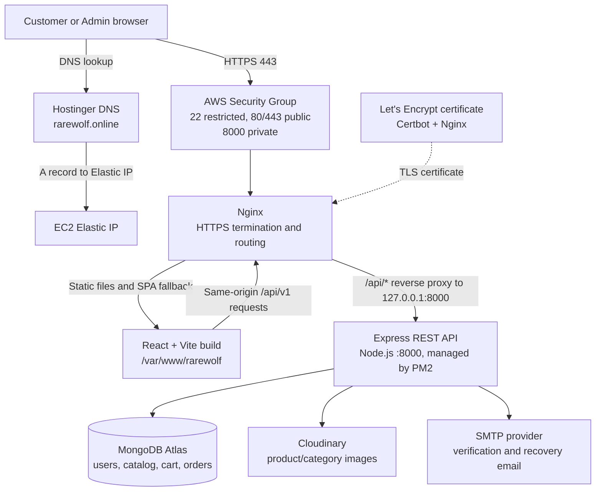
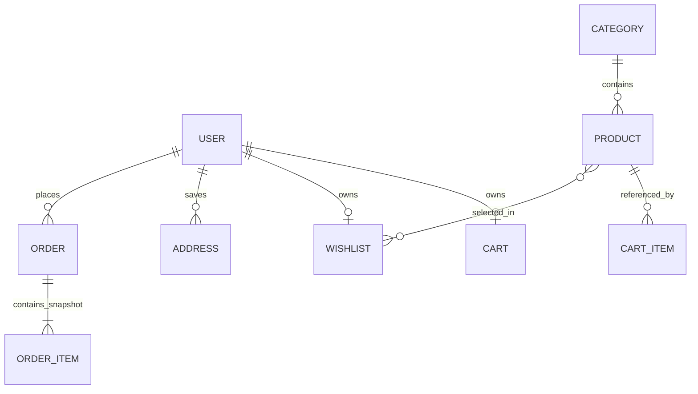
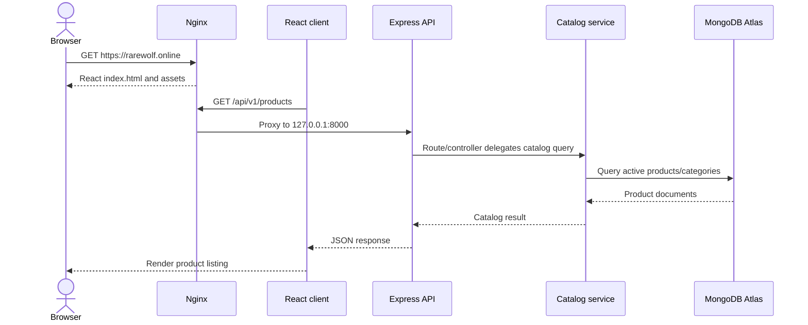

# RareWolf — Project Architecture and Interview Guide

> This document describes the current codebase and the deployment that was completed. It is written as an interview study guide. Replace secrets with placeholders whenever discussing configuration; never show `.env`, passwords, token secrets, SMTP credentials, Cloudinary secrets, or the EC2 private key.

## 1. Project summary

**RareWolf is a full-stack e-commerce web application.** Customers can browse products, create an account, verify their email, manage their profile and addresses, use a cart and wishlist, and place COD orders. Admin users can manage catalog and customer/order operations.

The application has a React single-page frontend and a versioned REST API built with Express. MongoDB Atlas stores application data. Cloudinary stores product/category images, and SMTP sends verification and password recovery emails.

### Main design goals

- Keep the frontend and API on one public HTTPS origin, simplifying browser cookies and API calls.
- Keep the Node API private behind Nginx rather than exposing port `8000` publicly.
- Separate route handling, request validation, controllers, services, models, and integrations.
- Store credentials in environment variables, outside the Git repository.
- Use role/verification middleware to protect customer and admin operations.

## 2. Architecture diagram



### Request path in plain language

1. The browser resolves `rarewolf.online` through DNS. Hostinger's root A record points to the EC2 Elastic IP.
2. The AWS Security Group allows public web traffic on ports 80 and 443. SSH port 22 is restricted to the administrator's IP. Port 8000 is not publicly open.
3. Nginx accepts the HTTPS request. Certbot/Let's Encrypt provisions the domain certificate used by Nginx.
4. For a page or asset request, Nginx serves the built files under `/var/www/rarewolf`. For React Router paths that are not physical files, `try_files` falls back to `index.html`.
5. The browser calls `/api/v1/...` on the same domain. Nginx proxies `/api/` to the Express API at `127.0.0.1:8000`.
6. Express validates the request, applies middleware, runs route/controller/service logic, reads or updates MongoDB, and returns JSON.
7. Where needed, the API sends email through SMTP or uploads/removes images through Cloudinary.

## 3. Deployment architecture

| Layer | Technology | Role |
| --- | --- | --- |
| Domain/DNS | Hostinger DNS | Maps the domain to the EC2 Elastic IP using A/CNAME records |
| Compute/OS | AWS EC2, Ubuntu | Runs Nginx and the Node.js API |
| Network access | AWS Security Group | Allows SSH from a limited IP and public HTTP/HTTPS; keeps API port private |
| TLS | Let's Encrypt + Certbot | Free TLS certificate installed into Nginx; HTTPS protects browser traffic |
| Web server/reverse proxy | Nginx | Serves React build, handles SPA fallback, routes `/api/` to Node |
| Frontend | React 19, Vite 8, React Router, Redux Toolkit, Axios, Tailwind CSS 4 | Browser UI, routes, state and API requests |
| API | Node.js 22, Express 5 | Versioned REST endpoints, business operations, auth and integrations |
| Persistence | MongoDB Atlas, Mongoose | Managed MongoDB database and schema/model layer |
| Process supervision | PM2 + systemd | Keeps API in background and restores it on instance reboot |
| Image service | Cloudinary | Product/category image upload and deletion |
| Email service | SMTP with Nodemailer | Verification and password-recovery messages |
| Source control | Git + GitHub | Stores source and lockfiles; excludes secrets/build output/dependencies |

**Important distinction:** Vite is used to build the frontend; it is not the production web server. The production `client/dist` build is served by Nginx. Nginx is also not the API: Express handles application logic.

## 4. Frontend architecture

The React client is a Vite-built single-page application (SPA).

- **React** renders the UI and reusable components.
- **React Router** handles browser-side routes and authenticated/admin route guards.
- **Redux Toolkit** stores application state. The configured slices include authentication, cart, and wishlist.
- **Axios** is the API client. It uses `VITE_API_BASE_URL` (production value `/api/v1`) and sends cookies with `withCredentials: true`.
- The Axios response interceptor attempts a refresh-token request after eligible `401` responses, then retries the original request once.
- **React Hook Form** handles form state; **Sonner/React Hot Toast** provide UI feedback; **Tailwind CSS 4** and its Vite plugin provide styling.
- In development, Vite proxies `/api` to `http://localhost:8000`. In production, Nginx takes over that proxy role.

Build command:

```bash
cd client
npm ci
npm run build
```

This emits static production files into `client/dist`. The deployed copy is `/var/www/rarewolf` so the Nginx worker can read it without opening up the user's home directory.

## 5. Backend architecture

The API uses Express and a layered structure:

```text
HTTP request
    ↓
Express app and shared middleware
    ↓
Versioned route (/api/v1/...)
    ↓
Authentication / role / verification / validation middleware
    ↓
Controller (HTTP request/response)
    ↓
Service (application/business operations)
    ↓
Mongoose model → MongoDB Atlas
    ↓
Standard JSON response or centralized error handler
```

### What the layers do

- **Routes** map HTTP methods and URL paths to middleware and controller methods.
- **Middleware** handles authentication, admin authorization, verified-user requirements, rate limiting, request validation, file upload handling, and errors.
- **Controllers** translate HTTP inputs/outputs and delegate application behavior.
- **Services** hold operations that may coordinate several models or integrations.
- **Models** define MongoDB document shape, validation, indexes, and selected model behavior.
- **Utilities** provide API errors/responses, logging, OTP/token helpers, Cloudinary, email and async error handling.

The app applies a request logger, CORS allowlist, JSON/urlencoded size limits, static/API middleware, cookie parsing, health route, feature routes and centralized error handling. The health endpoint is `GET /api/v1/health`; it returns success only when the Mongoose connection is ready.

### API route groups

| Prefix | Responsibility |
| --- | --- |
| `/api/v1/auth` | Registration, login/logout, token refresh, email verification, password recovery |
| `/api/v1/users` | Customer profile and account functions |
| `/api/v1/addresses` | Customer delivery addresses |
| `/api/v1/categories` | Category browsing and administration routes |
| `/api/v1/products` | Product catalog and product operations |
| `/api/v1/cart` | Customer cart |
| `/api/v1/orders` | Checkout/order history, order details and order operations |
| `/api/v1/wishlist` | Customer wishlist |
| `/api/v1/admin` | Admin overview, catalog/customer/order/inventory operations |

Admin endpoints are protected by authentication and admin-role middleware. Some customer actions require verified accounts.

## 6. Data model / MongoDB collections

Mongoose models currently include:

| Model | Main data and relationships |
| --- | --- |
| `User` | Name, unique email, password hash, optional unique phone, role (`user`/`admin`), email/phone verification flags, refresh/reset/verification state, active flag |
| `Category` | Name, unique slug, image URL and Cloudinary public ID, active flag |
| `Product` | Name, unique slug, description, price/MRP, rating, image metadata array, category reference, stock, active flag |
| `Cart` | One cart per user, product references and quantities |
| `Wishlist` | One wishlist per user, product references |
| `Address` | User-owned delivery addresses, with a partial unique index enforcing at most one default address per user |
| `Order` | User, item snapshots, delivery address snapshot, subtotal/shipping/total, COD payment method/status, fulfillment status/cancellation timestamp |

Product and order documents keep useful display snapshots such as product name, slug, image and unit price in order items. This preserves what was ordered even if a catalog product later changes.

### Simplified relationship diagram



`CART_ITEM` and `ORDER_ITEM` here are conceptual embedded subdocuments, not standalone collections. `Order` currently supports COD; payment status is tracked, but there is no payment gateway in this version.

## 7. Authentication, authorization and security

- Passwords are hashed using **bcrypt** before being stored.
- The API issues signed **JWT access and refresh tokens** using separate environment secrets and expiry settings.
- Tokens are delivered through **HTTP-only cookies**. In production the cookies use `Secure` and `SameSite=Lax` settings, so HTTPS is required.
- Authentication middleware verifies tokens and loads/identifies the user. Separate middleware checks admin role or verified-account requirements.
- CORS uses an explicit origin allowlist and credentials support. The production client/API share the same domain through Nginx.
- Request JSON and URL-encoded bodies have size limits; input validators use Joi; sensitive routes have rate limiting.
- The environment validator checks required values, valid MongoDB URL, allowed CORS origins, port ranges and production URL/secret requirements before the API listens.
- Nginx is the only public application entry point. Node listens on port 8000 locally; do not expose that port in the Security Group.
- Git ignores `.env`, `node_modules`, build output, logs and editor artifacts. Only `.env.example` with blank/placeholders belongs in source control.

> **Implementation note to know:** `TRUST_PROXY_HOPS` is validated in the environment module, but the `app.set("trust proxy", ...)` snippet in `server/src/app.js` is currently commented out. If relying on Nginx forwarded client IP/protocol in production (especially for rate limiting or secure request detection), enable and verify trust-proxy configuration with the intended proxy hop count.

## 8. External integrations and data flow

### Email (SMTP/Nodemailer)

The auth service uses SMTP through Nodemailer for verification and password recovery. SMTP credentials are server-side only. Errors are converted to safe API errors; credentials and OTP contents are not supposed to be logged.

### Images (Cloudinary)

Admin image uploads are validated for MIME type and a 5 MB limit. The server uploads image files to Cloudinary, persists secure URL/public ID references in MongoDB, and deletes temporary local upload files. Cloudinary stores the actual image bytes; MongoDB stores metadata/URLs.

### Example request flow: product listing



### Example request flow: signup/login

1. Browser posts credentials to `/api/v1/auth/...` over HTTPS.
2. Express validates the request and the auth service checks/creates the MongoDB user.
3. Password is bcrypt-hashed before storage; verification email is sent via SMTP when needed.
4. After successful authentication, the API returns user data and sets HTTP-only access/refresh cookies.
5. Browser requests include credentials. On an eligible expired access-token response, Axios attempts `/api/v1/auth/refresh-token` and retries the original request once.

## 9. Operations and deployment process

### Initial release

1. Commit source, package lock files and safe `.env.example` files to GitHub.
2. Create Ubuntu EC2, SSH key, Security Group and Elastic IP.
3. Install Node.js, Git and Nginx; clone the correct GitHub repository/branch.
4. Create the production-only `server/.env`; connect MongoDB Atlas, Cloudinary and SMTP.
5. Install API dependencies and start it with PM2; check local health endpoint.
6. Build frontend with `VITE_API_BASE_URL=/api/v1`.
7. Copy `client/dist` to `/var/www/rarewolf`; grant read access to `www-data`.
8. Configure Nginx static root, SPA fallback and `/api/` proxy; test with `nginx -t` and reload.
9. Point Hostinger A record to Elastic IP and `www` CNAME to root domain; preserve email DNS records.
10. Issue/install the HTTPS certificate; verify website and API health via domain.
11. Configure PM2 startup for systemd; `pm2 save`; verify `pm2-ubuntu` active and app online.

### Routine release

```bash
cd ~/rarewolf
git pull
cd server && npm ci && pm2 restart rarewolf-api && pm2 save
cd ../client && npm ci && npm run build
sudo cp -r dist/. /var/www/rarewolf/
sudo chown -R www-data:www-data /var/www/rarewolf
sudo nginx -t && sudo systemctl reload nginx
```

Run only the steps needed for the changed component; if dependencies did not change, reinstall is not necessary. Check API and browser after release.

### Useful operations commands

```bash
pm2 status
pm2 logs rarewolf-api --lines 50
pm2 monit
sudo systemctl status pm2-ubuntu --no-pager
sudo nginx -t
sudo tail -n 40 /var/log/nginx/error.log
curl -i http://127.0.0.1:8000/api/v1/health
curl -i https://rarewolf.online/api/v1/health
free -h
df -h
top
```

AWS EC2's default CloudWatch metrics provide CPU/network/status metrics. Guest RAM and filesystem usage need the CloudWatch Agent or can be checked directly with `free -h` and `df -h`.

## 10. Current scope and honest limitations

- Commerce orders use **Cash on Delivery**. There is no card/UPI payment gateway in this implementation.
- The backend, MongoDB, email, and Cloudinary depend on their external environment credentials and network access.
- A single EC2 instance is a straightforward first deployment, not a highly available multi-instance design. EC2 failure can make the site unavailable until recovery.
- The current website uses one Node API process under PM2 fork mode; scale-out, load balancer, CDN, automated deployment pipeline, backups/restore rehearsal and centralized alerting can be future improvements.
- For production growth, add automated CI/CD, database backup/restore checks, monitoring/alarms, least-privilege IAM, a managed secret store and tested rolling deployment.
- Do not claim payment gateway, high availability, autoscaling, or zero-downtime deployment unless those are actually implemented.

## 11. Interview answer: “Describe your project”

### 45-second version

“RareWolf is a full-stack e-commerce platform. I built the frontend with React and Vite, with React Router for navigation, Redux Toolkit for auth/cart/wishlist state, and Axios for API calls. The backend is a versioned REST API in Node and Express, organized into routes, middleware, controllers, services and Mongoose models. MongoDB Atlas stores users, catalog, carts, addresses, wishlists and orders. Authentication uses bcrypt-hashed passwords, JWT access/refresh tokens in HTTP-only cookies, email verification through SMTP, and role-based admin routes. Cloudinary stores product images. I deployed it on Ubuntu EC2: Nginx serves the production React build and reverse-proxies `/api` to the Node app on private port 8000; PM2 keeps the API running and systemd restores it after reboot. Hostinger DNS points the domain to an Elastic IP and the site is served over HTTPS.”

### One-minute architecture walkthrough

“A request first resolves the Hostinger domain to the EC2 Elastic IP. AWS Security Groups allow web traffic on 80/443 and restrict SSH; port 8000 is not public. Nginx terminates HTTPS and either serves the React static build or forwards `/api` to Express on localhost. Express middleware validates and authenticates the request, then routes it through a controller and service to a Mongoose model. MongoDB Atlas persists the records. When a feature needs email or images, the server calls SMTP/Nodemailer or Cloudinary. PM2 supervises the API, and a generated systemd service restores PM2's saved process list on reboot.”

### Questions interviewers may ask

**Why did you use Nginx?**  
To serve the static React build, provide SPA route fallback, terminate/route web traffic, and proxy `/api` to the private Node port so the browser uses one domain.

**Why use PM2 if systemd exists?**  
PM2 manages Node application processes, logs and restarts; systemd starts the PM2 daemon at machine boot. `pm2 save` records which apps should be resurrected.

**Why same-origin API?**  
The frontend calls `/api/v1` on the same host. This avoids separate frontend/API host configuration and fits the app's credentialed HTTP-only cookie authentication. Nginx forwards the API path internally.

**Where are images stored?**  
Image bytes live in Cloudinary; MongoDB stores secure URLs and public IDs. Temporary upload files are cleaned up by the API.

**What was a deployment issue you solved?**  
“The API health endpoint returned 200 but the domain returned an Nginx 500. Error logs showed Nginx could not traverse `/home/ubuntu` to read the Vite `dist` files. I moved the build to `/var/www/rarewolf`, assigned ownership to `www-data`, updated the Nginx root and reloaded Nginx.”

**How do you deploy a frontend change?**  
Pull the committed source, run the production Vite build, copy `dist` into `/var/www/rarewolf`, ensure ownership and reload Nginx. For API changes, pull/install if dependencies changed, restart the PM2 app and check health.

**How does it scale?**  
“The current deployment is a single EC2 instance. A next step would be separate stateless API instances behind an AWS load balancer, externalized secrets, managed observability/alarms, and tested database backups. The MongoDB layer is already hosted separately in Atlas.”

## 12. Final security reminder

Previously shared credentials should be treated as compromised. Rotate MongoDB, SMTP and Cloudinary credentials and use distinct strong token secrets. Update only the EC2 `server/.env`, restart the API, and verify health. Never commit or paste `.env` values, `.pem` private keys, access tokens, SMTP passwords or database connection strings.

